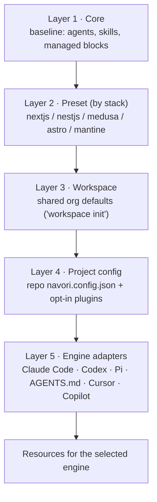
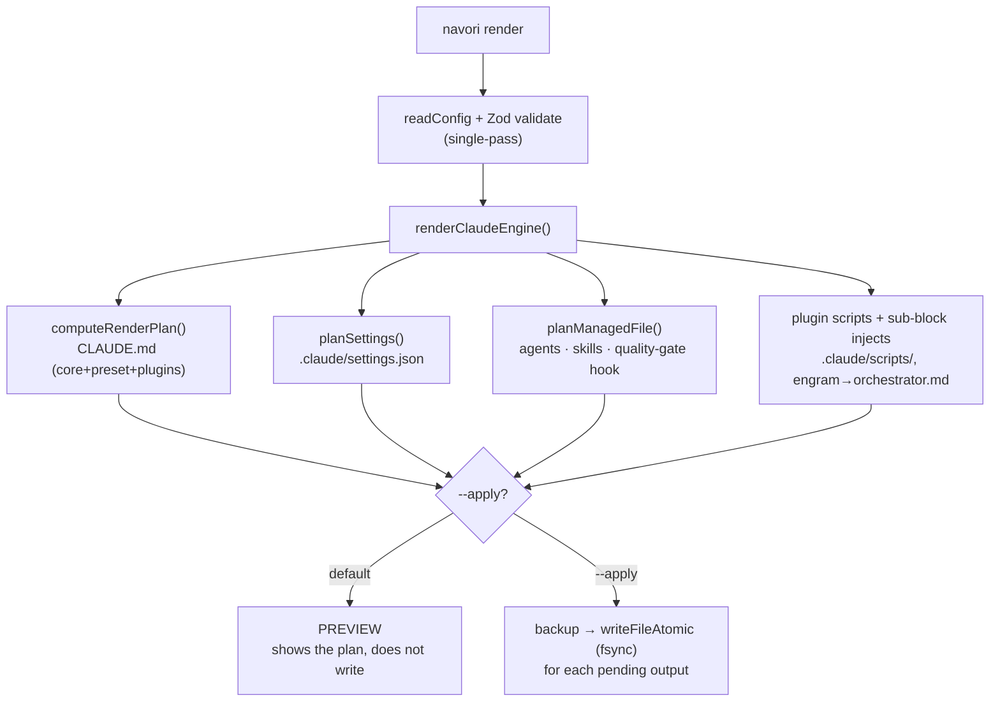
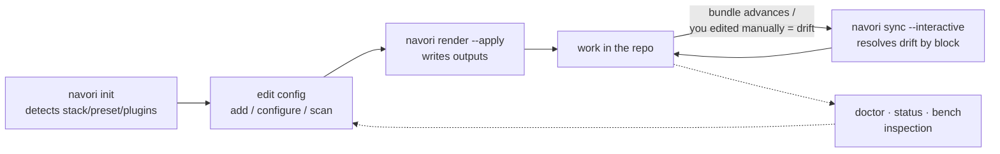

> [English](architecture.md) | [Español](architecture.es.md) | [简体中文](architecture.zh-CN.md)

# navori architecture — how it works (v0.12.0)

> Navigable diagrams: on GitHub, **click nodes** to jump to the source file. navori rebuilds
> engine-specific resources idempotently from a single source of truth (`navori.config.json`),
> without overwriting your manual work.

## 1. Layer model — where content comes from

The five cascading layers (a project design decision) each compose on top of the previous one. `navori.config.json` is the checked-in source of truth and materializes **layer 4 (Project config)**: it declares which preset to use, which workspace to inherit from, and which **plugins** to enable. Plugins are opt-in add-ons *within* Project config, not a separate layer. Layer 5 (Engine adapters) renders resources for the selected engine. The CLI currently includes adapters for Claude Code, Codex, Pi, AGENTS.md, Cursor, and Copilot; each adapter has its own output and supported controls, so this architecture guide does not imply feature parity. (In monorepos, `monorepo.workspaces[]` applies an override per app inside the Project layer.)



> **Plugins** (engram / gh / acli / tgrep / codegraph / cognitive) are declared in Project config
> and render applies them with core + preset — see the pipeline below. [packages/plugins/](../packages/plugins)

### Monorepo workspace harness (`monorepo.workspaceHarness`)

`monorepo.workspaceHarness` (`lib/config/schema.ts`) decides how much harness navori writes into each workspace. It is one value for the whole monorepo:

| Value | What the workspace receives |
|---|---|
| `minimal` (default) | Its context file plus skills the root does not already have. A workspace skill identical to the root one (normalized comparison, without frontmatter drift) is not duplicated. |
| `full` | Everything, as before the reduction. Restores the previous behavior byte for byte. |
| `root` | Only its context file (`CLAUDE.md`, and `AGENTS.md` under Codex). The root also writes library and preset skills that declare workspaces. |

`root` is for teams that always start the session at the repository root. The decision (`engines/shared/workspace-engine-decision.ts`) is made once before writing and shared by `render`, `sync`, and `doctor`, so preview, apply, and diagnosis use the same plan. In Claude, `sync` does not delete (`prune: false`); only `render` prunes. The Codex root destination in `sync` keeps the orphan pruning by marker that Codex already had. Anything removed by the reduction is backed up (`navori backup`).

`navori doctor` and stale-harness diagnosis (`lib/diagnose/stale-harness.ts`) treat `minimal` and `root` as reduced harness modes: they do not report as missing what the mode omits, and they do report navori-generated leftovers that the mode no longer writes. Under `full`, `doctor` adds an informational note: workspace hooks, agents, settings, and `.mcp.json` are not used if the session starts at the root; this does not change the health verdict.

Operational warnings when using `root`:

- **Update navori before setting it.** An older navori rejects `"root"` and therefore rejects the entire config (the enum is intentionally strict: silently falling back to `minimal` would recreate skills in every workspace). Update the whole team, CI, and the global CLI used by agents before editing the config.
- **Orphaned `<slug>-<id>` directories at the root.** If you rename or remove a workspace, the `<slug>-<id>` directories the root wrote for it are not detected or removed: pruning uses the current config and does not scan directories. Remove them manually.

## 2. Render pipeline — `navori render [--apply]`

`render` is **preview by default** (does not touch disk); `--apply` writes. Writing is atomic and preceded by a backup. `NAVORI_BENCH=1` instruments timing by step.



## 3. Command lifecycle — how you use it



## 4. Master plan — numbered stages and phases

The master plan organizes project work into independent, numbered, slugged stages, for example `01-mvp` and `02-payments`. Each stage has its own record under `specs/_master/`; the index says which stage is active, and closed stages remain read-only records.

The workflow moves through phases: `context` gathers the mode and input files; `transcribed` produces the code inventory and its digest; `mapped` generates and evaluates plans; `planned` records decisions; `questioned` consolidates `MASTER.md` and its parts; `mastered` waits for the command to begin; and `executing` starts the parts as specs. `navori master check` validates the active phase, and `navori master advance` moves it only when its criteria are met.

A stage can end normally with `navori master close` after execution. From `context` through `questioned`, the user can choose `close --convert` to turn the work into one spec; before `mastered`, `close --abandon` records abandonment. Closing preserves the stage record and updates master-plan state.

Mutable state — active stage, phase, mode, and each part's status or links — lives in schema-validatable JSON, so the CLI can check transitions and generate derived state. Plans, decisions, and `MASTER.md` content are prose authored in Markdown: they express human judgment and are checked against their structure, not parsed as the source of state. Derived state files such as `STATUS.md` are rendered.

**Deliveries for a part.** Each part's deliveries are validated against its `parts.json`, not Markdown. `navori master delivery-*` operates on the delivery phase: `delivery-baseline` records explicit baseline approval; `delivery-queue` authorizes a bounded queue of parts from a delivery (`--delivery E<n> --parts P<n>,…`); `delivery-slice` projects the authorized slice into a workplan; `delivery-revoke` withdraws the granted authority. `delivery-criterion`, `delivery-review`, `delivery-present`, `delivery-decision`, and `delivery-publication` cover each delivery's criteria, review, presentation, decision, and publication. Steps that authorize or approve require `--approved-by`, which must be `user`.

### 4.1 Specs in deliveries — `navori spec classify` and `check`

`navori spec classify <feature>` decides whether a spec ships in one PR or one PR per delivery by comparing tasks and estimated LOC against `sdd.deliveries` (`splitMinTasks`, `splitMinLoc`, `maxPrsPerSpec`; defaults 12, 1500, and 4). `navori spec check` validates `tasks.md`: milestones `M<n>`, criteria, `R<n>` coverage by `T<n>` tasks, and vertical `E<n>` deliveries. The full gate runs once per PR; `navori receipt gate` decides the gate by milestone.

## 5. The core: managed blocks

The whole model revolves around markers in generated files. Regeneration is idempotent and never overwrites anything outside the markers.

```text
<!-- navori:managed id="idioma-rol" hash="a1b2c3" version="0.0.1" source="@navori/core" -->
## Idioma y rol
- Código inglés. Chat español MX.            <- zona MANAGED (navori la regenera)
<!-- /navori:managed id="idioma-rol" -->

## Mis notas del proyecto                      <- zona USUARIO (navori nunca toca)
- lo que escribas acá sobrevive a todo render
```

- **`hash`** detects manual edits to the block (content drift). `sync` preserves it or resolves it interactively (keep-mine / accept-new).
- **`version`** is the navori version that last changed the block's content (or frontmatter), not the version that last rendered it. Re-rendering unchanged content with a newer CLI leaves the file byte-identical; unversioned blocks are stamped. The hash (sha1 of the body) does not change. `$navori.version` in `.claude/settings.json` and `.mcp.json` follows the same rule.
- **`harnessVersion`** (optional top-level key in `navori.config.json`) is the last navori version that applied a real change. It is written only by `render`/`sync`/`adopt --apply` when something was written or deleted; it never decreases, and is omitted with a warning if the file is not in the canonical JSON written by navori.
- **Anti-rollback (#79)** — per-block floor = max(`version` marker, `harnessVersion`). An older CLI skips (`downgrade-skipped`) blocks and JSON it would downgrade; `render --force` only overrides this in `settings.json`/`.mcp.json`. The full apply is not rejected. Accepted gap: an asset that goes A→B→A is protected only if the newer CLI applied another real change.
- **Outside the markers** — yours, untouched. That is the moat: idempotent regeneration without destroying your work. See [marker.ts](../packages/cli/src/lib/render/marker.ts).

### Resolving complete files in `sync`

A complete managed file (agent, skill, hook, plugin script, `AGENTS.md`, etc.) edited manually can be resolved only if it retains the navori marker for its ID. The engine then attaches `SkippedFile.resolution` (`absPath`, `basis`, `content`, `chmodExec?`), calculated only after `user-modified-skipped` — after anti-rollback, so a `downgrade-skipped` never carries it — and only for a regular, non-symlink target. It is not attached to files without a marker, sub-block skips, settings, or Pi; nor when forced rendering would produce the same file or fails. The field's presence is the only criterion for “resolvable,” and no output JSON includes the content.

- **`sync --interactive`** (or the “resolve one by one” option offered when there are block conflicts or resolvable files) shows each file's diff and asks keep/accept. All answers are collected before writing; cancelling writes nothing.
- **Writing:** accepted files are written with `commitWrites` and a `<target>:sync` backup before normal apply. Immediately before each write, the file is checked again to confirm it is still regular and matches the displayed `basis` (TOCTOU); otherwise it is discarded with a warning and the others continue. If a write fails, earlier files remain written (with their backups printed), later writes are not attempted, and the command exits 1. Repeating the command is idempotent.
- **`--accept-new-files`** accepts every resolvable file without asking. It writes only with `--apply` or `--yes` (otherwise it previews); it combines with `--accept-new` and is rejected with `--keep-mine` (`bulk-flags-conflict`) and `--interactive` (`bulk-flags-interactive`). `--yes` still exits 1 if unanswered CLAUDE.md block conflicts remain; `--accept-new` alone never touches complete files (CI semantics stay intact, #523).
- **`sync --json`** adds `acceptNewFiles` and, per conflict, `resolvable` (`bulk` | `none`), never `basis` or content. It reports the post-resolution state: resolved files leave `conflicts[]` and `targets[].skipped`, and enter `written`/`backups`.
- **`resolution` and `markerlessResolution`:** a file retaining its complete marker has `resolution` (bulk-resolvable). One with no `navori:managed` text (plugin scripts that #1242 does not adopt, `foreign` assets) has `markerlessResolution`: complete-file replacement available only with `--interactive`, using a fresh render (`existingContent` null, #637), a neutral warning, default “keep,” and backup under `~/.navori/backups` (30 days; `navori backup restore`). Bulk flags (`--accept-new-files`, `--yes`, `--json`, `--dry-run`) never read it: `resolvable` stays `none` and the JSON shape does not change; without an interactive answer, a `sync.markerlessFilesInteractiveOnly` warning appears. A partial marker or a mention of `navori:managed` in a comment has neither field: resolve manually, move it aside, and run `navori render --apply`.

See [sync.ts](../packages/cli/src/commands/sync.ts) and [execute-plan.ts](../packages/cli/src/engines/shared/execute-plan.ts).

## 6. Claude Code permission modes — reference table

Lookup reference, not an always-on instruction: the managed `operaciones-seguras` block only links here. The host sets the mode, not the agent. Official docs: https://code.claude.com/docs/en/permission-modes

| Mode | Runs without asking | What it changes for you |
|---|---|---|
| `default` | reads only | every edit and command prompts: batch them and explain before asking |
| `acceptEdits` | reads, edits, common FS commands | edit freely; the shell still prompts outside the read-only set |
| `plan` | reads, plus classifier-approved commands | **you do not write**: the architectural pass, `auditor`, and an SDD spec ARE this mode's work; leave the mode to execute |
| `auto` | everything, classifier-reviewed | every shell command pays a classifier round-trip; reads, in-workspace edits, and `allow`-covered MCP calls do not, so `cmd1 && cmd2` in one call beats two |
| `dontAsk` | only what is pre-approved | `Edit`/`Write` are NOT in navori's `allow`, and the mode denies `AskUserQuestion` outright: the implement/review cycle cannot run. The one mode navori does not support today — use `default`, `acceptEdits`, `plan`, or `auto` |
| `bypassPermissions` | everything | prompts are skipped and `allow` rules have no effect — but `deny` rules still block, in this and every other mode, as does the hook (`exit 2` blocks in any mode). Isolated environments only |

### 6.1 Hook blocks — hard / ask / advisory classification

Each managed script with `exit 2` declares its classification in the header `# Blocking classification (#1117):` (required by `hook-claims-vs-scripts.test.ts`).

| Class | Meaning | Hooks |
|---|---|---|
| `hard` | There is a verdict or a containment action; nothing is available to approve | `guard-destructive` (limits, `--no-verify`, force-push to base, `rm` on root/home/system, rewriting managed files, discarding a whole tree with uncommitted work: `git reset --hard`, `git checkout -f` / `git checkout .`, `git restore` paths without `--staged`, `git clean -f`), `plan-gate` with a denied plan, `quality-gate-pre-commit` with invalid cwd or failing gate, `role-guard`, `implementer-no-markdown`, `subagent-no-background`, `engram-write-guard` |
| `ask` | No verdict is available (the tool is missing); the human decides in the UI | `plan-gate` with navori missing or without the `plan` subcommand; `quality-gate-pre-commit` with missing runner |
| `advisory` | `PostToolUse`: `exit 2` reaches only the model | `managed-drift-watch` |

Block messages are actionable: when a safe route exists, the `route:` line names it (for example, a literal directory with `git -C <dir>` or splitting the command). Blocks with no safe route (`rm` on root or home, fork bomb, block devices) do not include one.

`ask` is emitted only if `navori_can_ask` ([gate-ask.sh](../packages/core/core-assets/hooks/_partials/gate-ask.sh)) allows it: non-Codex script, `jq`, `PreToolUse` payload, and `permission_mode` in `default`, `acceptEdits`, or `auto`. `plan` is excluded (it can run with prompts disabled); empty, absent, or unknown modes are excluded too. Outside the allowlist, the gate blocks with `exit 2`, so `ask` never becomes a silent allow. Codex ignores `permissionDecision`: there it is always `exit 2`. Confirmation hooks (`master-accept`, `comment-draft`, etc.) keep `ask` in every mode; their fallback is allow.

Host contract for a hook `ask` (Claude Code docs):

| Mode | Hook `ask` | `exit 2` | Settings `ask` rule |
|---|---|---|---|
| `default`, `acceptEdits`, `plan` | asks | blocks | asks |
| `auto` | forces the prompt | blocks | asks |
| `dontAsk` | denies by itself | blocks | denies |
| `bypassPermissions` | undocumented | blocks | asks |
| `-p` | denies | blocks | denies unless permission host |

`guard-destructive` does not ask. For `rm` on a variable, it blocks and its message gives the literal form `rm -rf <absolute path>`, which the `ask` rule in `settings-base.json` turns into native confirmation. Residual: that rule matches literal spellings only; other forms remain blocked.

Audit: `navori_audit_log` derives `kind` from the verdict (`block` → `hard`, `ask` → `ask`; explicit `deny`) and `reason` is one code from the `HOOK_REASON_CODES` allowlist ([model.ts](../packages/cli/src/lib/audit/model.ts)), mirrored by the partial's `jq` list (a test detects drift). Any other text is recorded as `unspecified`.

### 6.2 Codex notes

- **Thinner `AGENTS.md`:** Codex omits the skills index (it lists skills natively), reduces the agent roster to one clause, and includes `qualityGate.full` only once, in `orquestacion.md`.
- **No model downgrade with an old catalog:** a catalog written by an older Codex client does not lower the model already rendered. A `previous` from the same family with a higher version than the catalog is preserved.
- **Engram write guard for subagents:** `engram-write-guard` applies a role policy. `auditor` reads and saves (`mem_save`); `implementer`, `reviewer`, and `scout` only read; `architect`, `publisher`, and `scribe` have no access; all others are read-only. Denied access exits with `exit 2`. Without `jq` or `node`, the hook also blocks; in repositories without engram it is inert.

## 7. Retiring plugins

A retired plugin (`RETIRED_PLUGINS`, in [lib/config/plugins.ts](../packages/cli/src/lib/config/plugins.ts)) no longer has a manifest, so nothing can re-render its scripts to compare bytes. The verdict comes from the file itself and who can still call it. The policy lives in [engines/shared/retired-plugin-assets.ts](../packages/cli/src/engines/shared/retired-plugin-assets.ts) and is shared by three deletion sites: the Claude sweep, the `.codex/scripts` sweep, and `render --prune`. A path is deleted only when `retiredAssetKeepReason` returns `null`; otherwise it is preserved, render warns with the reason, and `doctor` reports it.

**Ownership.** Evaluation is per file (a directory is traversed completely; a symlink anywhere preserves it). A file belongs to navori if it meets one of three conditions:

- intact managed marker (verified hash, not sealed by a newer navori) and nothing outside the managed block;
- no marker, but byte-for-byte equal to the pre-#637 render (legacy fingerprint, in [legacy-plugin-script-fingerprints.ts](../packages/cli/src/engines/shared/legacy-plugin-script-fingerprints.ts));
- no marker, and the registry entry declares `deleteForeign` (script remnants from before script markers, not listed in the fingerprint table).

An intact marker with content outside the block is preserved as `modified`.

**References.** A navori file is still preserved if something can call it:

- `native-hook-declared`: `plugins.<id>.nativeHook: true`; the user wired it manually, possibly through a path no scan follows.
- `settings-referenced`: a config containing hooks that this render did not rewrite (`settings.json` or `config.toml` omitted, or `.claude/settings.local.json`) names the script.
- `hook-referenced`: a hook source names the script.

Other preservation reasons (`foreign`, `newer`, `modified`, `ephemeral`, `symlink`) are in `KeepReason` in [lib/render/removable.ts](../packages/cli/src/lib/render/removable.ts). The search is a basename substring match and is conservative: a comment naming the script also preserves it.

**Hook sources read.** `readHookSources`, in [lib/diagnose/native-hooks.ts](../packages/cli/src/lib/diagnose/native-hooks.ts), runs lazily once per render:

- the hook directory resolved by git (respects `core.hooksPath`, excludes `.sample` files) and `.husky/**`;
- lefthook configs (`lefthook*` and `.lefthook/`, at the root and in `.config/`), `.pre-commit-config.yaml`, `.overcommit.yml`, `package.json`, `Makefile`, and `.github/workflows/*.yml|yaml`;
- one delegation hop: a repository-relative path naming a hook entry is also read.

**Not detected:** two or more delegation hops, runtime-constructed paths, callers outside the repository (IDE tasks, other CI), and lefthook `extends` or `remotes`.

**Retired blocks.** Managed blocks and sub-blocks for retired plugins are removed from `CLAUDE.md` and skills files, with a guard (#1273): a manually edited block is marked `retired-kept`, and one sealed by a newer navori is `downgrade-skipped`. Neither counts as a conflict.

**`doctor`.** `scanRetiredPluginLeftovers`, in [lib/diagnose/health.ts](../packages/cli/src/lib/diagnose/health.ts), reports retired IDs still declared in the config, retired scripts on disk with their preservation reason (or without one if the next `render --apply` will delete them), retired blocks present, and references in hook sources; it sets `scriptMissing` when the script no longer exists. These are warnings only: they do not enter `computeHealthVerdict`, so they do not change `ok`, exit 2, or `--strict`.

## Key files

| Component | File |
|---|---|
| Config + schema (Zod) | [lib/config/schema.ts](../packages/cli/src/lib/config/schema.ts) · [lib/config/config.ts](../packages/cli/src/lib/config/config.ts) |
| Render plan (CLAUDE.md) | [lib/render-plan.ts](../packages/cli/src/lib/render/render-plan.ts) |
| Managed markers (inject/diff/hash) | [lib/marker.ts](../packages/cli/src/lib/render/marker.ts) |
| Claude engine | [engines/claude/index.ts](../packages/cli/src/engines/claude/index.ts) |
| Settings deep merge | [engines/claude/build-settings.ts](../packages/cli/src/engines/claude/build-settings.ts) |
| Agent/skill/hook rendering | [engines/shared/render-managed-file.ts](../packages/cli/src/engines/shared/render-managed-file.ts) |
| Presets / Plugins | [lib/presets.ts](../packages/cli/src/lib/config/presets.ts) · [lib/plugins.ts](../packages/cli/src/lib/config/plugins.ts) |
| Health check (doctor/status) | [lib/diagnose/health.ts](../packages/cli/src/lib/diagnose/health.ts) |
| Stack detection | [lib/diagnose/detect.ts](../packages/cli/src/lib/diagnose/detect.ts) |
| Commands | [src/commands/](../packages/cli/src/commands) |
| Bundled assets | [core-assets/](../packages/core/core-assets) · [plugins/](../packages/plugins) |

> The release plan that produced v0.2 is in
> [specs/0003-v0.2-quality-velocity-tokens/design.md](../specs/0003-v0.2-quality-velocity-tokens/design.md).
