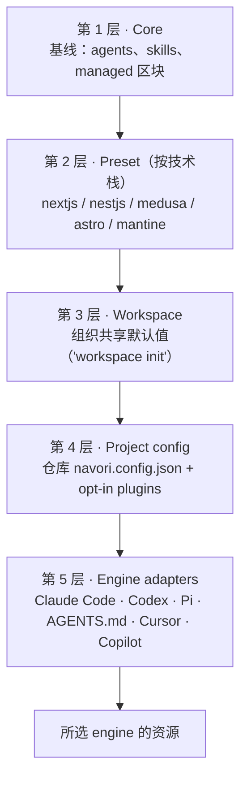
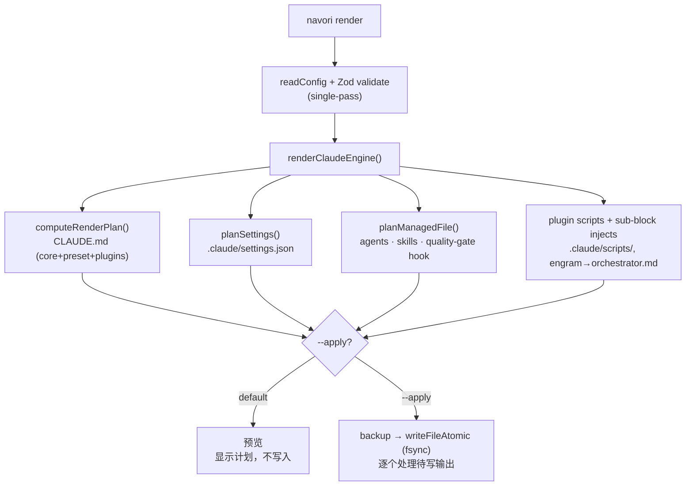
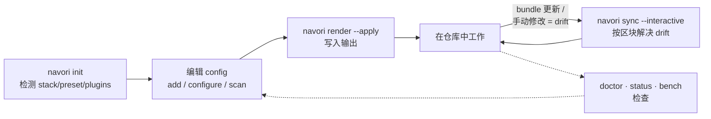

> [English](architecture.md) | [Español](architecture.es.md) | [简体中文](architecture.zh-CN.md)

# navori 架构 — 工作原理 (v0.12.0)

> 可导航图表：在 GitHub 上，**点击节点**即可跳转到源文件。navori 从唯一事实来源（`navori.config.json`）幂等地重建所选 engine 的资源，不会覆盖你的手动修改。

## 1. 分层模型 — 内容来源

五层级联（项目的设计决策），每一层都在上一层的基础上组合。`navori.config.json` 是签入仓库的事实来源，体现**第 4 层（Project config）**：声明使用哪个 preset、继承哪个 workspace，以及启用哪些**插件**。插件是 Project config *内部*的 opt-in 扩展，不是单独的一层。第 5 层（Engine adapters）为选定的 engine 渲染资源。CLI 目前包含 Claude Code、Codex、Pi、AGENTS.md、Cursor 和 Copilot 的 adapters；各 adapter 有自己的输出和支持的控制项，因此本文不表示它们具备功能对等性。（在 monorepo 中，`monorepo.workspaces[]` 会在 Project 层内为每个 app 应用覆盖值。）



> **Plugins**（engram / gh / acli / tgrep / codegraph / cognitive）在 Project config 层中声明，render 会将它们与 core + preset 一起应用——见下方 pipeline。[packages/plugins/](../packages/plugins)

### Monorepo workspace harness (`monorepo.workspaceHarness`)

`monorepo.workspaceHarness`（`lib/config/schema.ts`）决定 navori 要向每个 workspace 写入多少 harness。整个 monorepo 只有一个取值：

| 取值 | Workspace 会获得什么 |
|---|---|
| `minimal`（默认） | 自己的 context 文件，以及根目录尚未提供的 skills。workspace 中与根目录相同的 skill（规范化比较，不包含 frontmatter 漂移）不会重复。 |
| `full` | 所有内容，与精简前相同。逐字节恢复以前的行为。 |
| `root` | 只有自己的 context 文件（`CLAUDE.md`，Codex 下还有 `AGENTS.md`）。根目录也会写入声明 workspace 的 library 和 preset skills。 |

`root` 适用于总是在仓库根目录启动会话的团队。该决定（`engines/shared/workspace-engine-decision.ts`）在写入前只计算一次，由 `render`、`sync` 和 `doctor` 共用，因此 preview、apply 和诊断都采用同一计划。对于 Claude，`sync` 不会删除（`prune: false`），只有 `render` 会清理。Codex 的 `sync` 根目录目标保留了 Codex 原有的按 marker 清理孤儿文件行为。精简时删除的内容会先备份（`navori backup`）。

`navori doctor` 和过时 harness 诊断（`lib/diagnose/stale-harness.ts`）会把 `minimal` 和 `root` 视为精简 harness 模式：模式省略的内容不会被报告为缺失；navori 生成但模式不再写入的残留内容会被报告。在 `full` 下，`doctor` 会添加一条提示：如果会话从根目录启动，workspace 的 hooks、agents、settings 和 `.mcp.json` 不会使用；这不会改变健康判定。

使用 `root` 时的操作警告：

- **设置前先更新 navori。** 旧版 navori 会拒绝 `"root"`，并因此拒绝整个 config（enum 有意保持严格：静默回退到 `minimal` 会在每个 workspace 中重新创建 skills）。编辑 config 前，先更新整个团队、CI 和 agents 使用的全局 CLI。
- **根目录中孤立的 `<slug>-<id>` 目录。** 重命名或删除 workspace 后，根目录此前为它写入的 `<slug>-<id>` 目录不会被发现或删除：清理只依据当前 config，不扫描目录。请手动删除这些目录。

## 2. Render pipeline — `navori render [--apply]`

`render` **默认执行 preview**（不写磁盘）；`--apply` 才会写入。写入是原子的，并且会先备份。`NAVORI_BENCH=1` 会记录每个步骤的耗时。



## 3. 命令生命周期 — 如何使用



## 4. Master plan — 编号阶段与 phase

Master plan 将项目工作组织为彼此独立、带编号和 slug 的阶段，例如 `01-mvp` 和 `02-payments`。每个阶段在 `specs/_master/` 下都有自己的记录；索引指出当前活跃阶段，已关闭阶段则保留为只读记录。

流程按 phase 推进：`context` 收集模式和输入文件；`transcribed` 生成代码清单及其 digest；`mapped` 生成并评估计划；`planned` 记录决策；`questioned` 汇总 `MASTER.md` 及其 parts；`mastered` 等待开始命令；`executing` 将各 part 作为 specs 启动。`navori master check` 会验证当前活跃 phase；只有符合标准时，`navori master advance` 才会推进它。

执行完成后，可以用 `navori master close` 正常结束一个阶段。从 `context` 到 `questioned`，用户可以选择 `close --convert`，将工作转换为单一 spec；在 `mastered` 之前，`close --abandon` 会记录放弃。关闭操作会保留阶段记录并更新 master plan 状态。

可变状态——活跃阶段、phase、模式以及每个 part 的状态或链接——存放在可进行 schema 验证的 JSON 中，这样 CLI 可以检查状态转换并生成派生状态。计划、决策和 `MASTER.md` 内容是用 Markdown 编写的 prose：它们表达人的判断，按结构验证，而不是解析为状态来源。派生状态文件（例如 `STATUS.md`）由 render 生成。

**Part 的 deliveries。** 每个 part 的 deliveries 都根据它自己的 `parts.json` 验证，而不是根据 Markdown。`navori master delivery-*` 操作 delivery phase：`delivery-baseline` 记录明确的基线批准；`delivery-queue` 授权某个 delivery 中有界限的 part 队列（`--delivery E<n> --parts P<n>,…`）；`delivery-slice` 将获授权的 slice 投射到 workplan；`delivery-revoke` 撤销已授予的权限。`delivery-criterion`、`delivery-review`、`delivery-present`、`delivery-decision` 和 `delivery-publication` 分别处理每个 delivery 的标准、review、展示、决策和发布。授予权限或批准的步骤都要求 `--approved-by`，且其值必须是 `user`。

### 4.1 按 delivery 交付 specs — `navori spec classify` 和 `check`

`navori spec classify <feature>` 会比较任务数和估计 LOC 与 `sdd.deliveries`（`splitMinTasks`、`splitMinLoc`、`maxPrsPerSpec`；默认值为 12、1500、4），以决定 spec 通过一个 PR 交付，还是每个 delivery 一个 PR。`navori spec check` 会验证 `tasks.md`：milestones `M<n>`、标准、`T<n>` 任务对 `R<n>` 的覆盖，以及垂直交付 `E<n>`。每个 PR 只运行一次完整 gate；每个 milestone 的 gate 由 `navori receipt gate` 决定。

## 5. 核心：managed 区块

整个模型围绕生成文件中的 markers 运作。重新生成是幂等的，绝不会覆盖 marker 之外的内容。

```text
<!-- navori:managed id="idioma-rol" hash="a1b2c3" version="0.0.1" source="@navori/core" -->
## Idioma y rol
- Código inglés. Chat español MX.            <- zona MANAGED (navori la regenera)
<!-- /navori:managed id="idioma-rol" -->

## Mis notas del proyecto                      <- zona USUARIO (navori nunca toca)
- lo que escribas acá sobrevive a todo render
```

- **`hash`** → 检测区块是否被手动编辑（内容 drift）。`sync` 会保留它或以交互方式解决（keep-mine / accept-new）。
- **`version`** → 最近一次修改区块内容（或其 frontmatter）的 navori 版本，而不是最近一次渲染它的版本。使用更新的 CLI 对未变内容重新 render，文件会保持逐字节相同；无版本的区块才会被标记。hash（body 的 sha1）不会改变。`.claude/settings.json` 和 `.mcp.json` 中的 `$navori.version` 遵循同一规则。
- **`harnessVersion`**（`navori.config.json` 可选的顶层键）→ 最近一次实际应用变更的 navori 版本。只有当 `render`/`sync`/`adopt --apply` 写入或删除了内容时才会写入；它不会降低。如果文件不在 navori 写入的规范 JSON 中，则会省略并发出警告。
- **Anti-rollback (#79)** → 每个区块的最低版本 = max（marker 的 `version`、`harnessVersion`）。较旧的 CLI 会跳过（`downgrade-skipped`）它会降级的区块和 JSON；`render --force` 仅在 `settings.json`/`.mcp.json` 中覆盖此保护。整个 apply 不会被拒绝。已接受的缺口：资源从 A→B→A 时，只有在较新 CLI 应用了其他实际变更后才受保护。
- **Marker 之外** → 属于你，不可触碰。这就是护城河：幂等重新生成而不破坏你的工作。参见 [marker.ts](../packages/cli/src/lib/render/marker.ts)。

### 在 `sync` 中解决完整文件

完整的 managed 文件（agent、skill、hook、plugin script、`AGENTS.md` 等）若被手动编辑，只有保留 navori 对应 ID 的 marker 才能解决。此时 engine 会附加 `SkippedFile.resolution`（`absPath`、`basis`、`content`、`chmodExec?`）；它只会在 `user-modified-skipped` 之后计算——也就是 anti-rollback 之后，因此 `downgrade-skipped` 从不会携带该字段——且目标必须是常规文件，不能是 symlink。无 marker 的文件、子区块 skip、settings 和 Pi 都不会附加它；强制 render 结果与文件相同或失败时也不会附加。字段是否存在是唯一的“可解决”标准，输出 JSON 不包含内容。

- **`sync --interactive`**（或存在区块冲突/可解决文件时提供的“逐个解决”选项）会显示每个文件的 diff 并询问 keep/accept。写入前会先收集所有答案；取消不会写入任何内容。
- **写入：**已接受的文件会由 `commitWrites` 写入，正常 apply 前会创建 `<target>:sync` 备份。每次写入前都会重新确认文件仍是常规文件，且仍与展示的 `basis` 相同（TOCTOU）；否则会丢弃该项并发出警告，其他项继续。如果写入失败，之前的文件仍已写入（并打印其备份），后续文件不再尝试，命令以 exit 1 结束。重复运行命令是幂等的。
- **`--accept-new-files`** 会在不询问的情况下接受所有可解决文件。只有带 `--apply` 或 `--yes` 才会写入（否则是 preview）；它可与 `--accept-new` 一起使用，但与 `--keep-mine`（`bulk-flags-conflict`）和 `--interactive`（`bulk-flags-interactive`）一起使用时会被拒绝。若 CLAUDE.md 仍有未回答的区块冲突，`--yes` 仍以 1 退出；单独使用 `--accept-new` 从不会触碰完整文件（CI 语义保持不变，#523）。
- **`sync --json`** 添加 `acceptNewFiles`，并为每个冲突添加 `resolvable`（`bulk` | `none`），绝不会包含 `basis` 或内容。它报告解决后的状态：已解决文件会从 `conflicts[]` 和 `targets[].skipped` 移出，并进入 `written`/`backups`。
- **`resolution` 和 `markerlessResolution`：**保留完整 marker 的文件会有 `resolution`（可批量解决）。完全没有 `navori:managed` 文本的文件（#1242 未接管的 plugin scripts、`foreign` 资源）会有 `markerlessResolution`：只能通过 `--interactive` 替换整个文件，使用新鲜 render（`existingContent` 为 null，#637），给出中性警告，默认选择“保留”，并备份到 `~/.navori/backups`（保留 30 天；`navori backup restore`）。批量 flags（`--accept-new-files`、`--yes`、`--json`、`--dry-run`）从不读取它：`resolvable` 仍为 `none`，JSON 结构不变；没有交互回答时会显示 `sync.markerlessFilesInteractiveOnly`。部分 marker 或注释中的 `navori:managed` 字样都不产生这两个字段：需手动解决、将文件移到一旁，再运行 `navori render --apply`。

参见 [sync.ts](../packages/cli/src/commands/sync.ts) 和 [execute-plan.ts](../packages/cli/src/engines/shared/execute-plan.ts)。

## 6. Claude Code 权限模式 — 参考表

这是查询参考，不是始终启用的指令：managed 的 `operaciones-seguras` 区块只链接到这里。模式由 host 设置，不由 agent 设置。官方文档：https://code.claude.com/docs/en/permission-modes

| 模式 | 无需询问即可执行 | 对你的影响 |
|---|---|---|
| `default` | 仅读取 | 每次编辑和每条命令都会询问：先批量整理，并在询问前说明理由 |
| `acceptEdits` | 读取、编辑、常见文件系统命令 | 可自由编辑；只读集合以外的 shell 命令仍会询问 |
| `plan` | 读取，以及 classifier 批准的命令 | **你不能写入**：架构分析、`auditor` 和 SDD spec 就是此模式的工作；执行时需离开该模式 |
| `auto` | 所有操作，但要经过 classifier 审查 | 每条 shell 命令都要支付一次 classifier 往返；读取、工作区内编辑和被 `allow` 覆盖的 MCP 调用无需支付，因此一次调用中的 `cmd1 && cmd2` 优于分成两次 |
| `dontAsk` | 仅预先批准的操作 | `Edit`/`Write` 不在 navori 的 `allow` 中，而且该模式会直接拒绝 `AskUserQuestion`：implement/review 循环无法执行。这是 navori 当前不支持的唯一模式——请用 `default`、`acceptEdits`、`plan` 或 `auto` |
| `bypassPermissions` | 所有操作 | 跳过询问，`allow` 规则不再生效；但 `deny` 规则仍会阻止操作，此模式和所有其他模式都一样；hook 也仍会阻止（任何模式下 `exit 2` 都是阻止）。仅用于隔离环境 |

### 6.1 Hook 阻止 — hard / ask / advisory 分类

每个以 `exit 2` 结束的 managed script 都会在 header `# Blocking classification (#1117):` 中声明分类（`hook-claims-vs-scripts.test.ts` 要求如此）。

| 类别 | 含义 | Hooks |
|---|---|---|
| `hard` | 已有判定或隔离措施；没有可批准的操作 | `guard-destructive`（限制、`--no-verify`、向 base force-push、对 root/home/system 使用 `rm`、重写 managed 文件、丢弃仍有未提交工作的整个工作树：`git reset --hard`、`git checkout -f` / `git checkout .`、未带 `--staged` 的 `git restore` 路径、`git clean -f`），被拒绝 plan 的 `plan-gate`，cwd 无效或 gate 失败时的 `quality-gate-pre-commit`，`role-guard`、`implementer-no-markdown`、`subagent-no-background`、`engram-write-guard` |
| `ask` | 缺少工具，无法判定；由人通过 UI 决定 | 缺少 navori 或没有 `plan` 子命令时的 `plan-gate`；缺少 runner 时的 `quality-gate-pre-commit` |
| `advisory` | `PostToolUse`：`exit 2` 只会到达模型 | `managed-drift-watch` |

阻止消息可直接采取行动：若存在安全路径，`route:` 行会写明做法（例如用字面目录执行 `git -C <dir>`，或拆分命令）。没有安全路径的阻止（对 root 或 home 执行 `rm`、fork bomb、块设备）不会提供 route。

只有当 `navori_can_ask`（[gate-ask.sh](../packages/core/core-assets/hooks/_partials/gate-ask.sh)）允许时才会发出 `ask`：非 Codex script、`jq`、`PreToolUse` payload，并且 `permission_mode` 是 `default`、`acceptEdits` 或 `auto`。`plan` 被排除（它可以在关闭 prompts 时运行）；空值、缺失或未知值也会排除。在 allowlist 之外，gate 会用 `exit 2` 阻止，因此 `ask` 不会静默变成 allow。Codex 忽略 `permissionDecision`：在那里始终是 `exit 2`。确认 hooks（`master-accept`、`comment-draft` 等）在所有模式下都保留 `ask`，其回退行为是允许。

Claude Code 文档中的 host `ask` 契约：

| 模式 | Hook `ask` | `exit 2` | Settings `ask` 规则 |
|---|---|---|---|
| `default`、`acceptEdits`、`plan` | 询问 | 阻止 | 询问 |
| `auto` | 强制显示询问 | 阻止 | 询问 |
| `dontAsk` | 自动拒绝 | 阻止 | 拒绝 |
| `bypassPermissions` | 未记录 | 阻止 | 询问 |
| `-p` | 拒绝 | 阻止 | 拒绝，除非由 permission host 处理 |

`guard-destructive` 不会询问。对变量执行 `rm` 时，它会阻止并在消息中给出字面形式 `rm -rf <absolute path>`，`settings-base.json` 的 `ask` 规则会将其转为原生确认。残余限制：该规则只匹配字面拼写；其他形式仍会被阻止。

审计：`navori_audit_log` 根据判定推导 `kind`（`block` → `hard`，`ask` → `ask`；显式 `deny`），`reason` 是 `HOOK_REASON_CODES` allowlist（[model.ts](../packages/cli/src/lib/audit/model.ts)）中的单一代码，与 partial 的 `jq` 列表保持镜像（测试会检查漂移）。其他文本都会被记录为 `unspecified`。

### 6.2 Codex 说明

- **更精简的 `AGENTS.md`：**Codex 会省略 skills 索引（它会原生列出 skills），将 agent roster 缩成一个分句，并且只在 `orquestacion.md` 中出现一次 `qualityGate.full`。
- **目录过旧时不降低模型档位：**由旧 Codex 客户端写入的目录不会降低已 render 的模型。同系列中版本高于目录的 `previous` 会保留。
- **subagent 的 Engram 写入守卫：**`engram-write-guard` 按角色实施策略。`auditor` 可以读取并保存（`mem_save`）；`implementer`、`reviewer`、`scout` 只能读取；`architect`、`publisher`、`scribe` 无权访问；其他角色只能读取。拒绝访问时以 `exit 2` 退出。缺少 `jq` 或 `node` 时 hook 也会阻止；没有 engram 的仓库中 hook 不生效。

## 7. 退役插件

退役插件（`RETIRED_PLUGINS`，位于 [lib/config/plugins.ts](../packages/cli/src/lib/config/plugins.ts)）不再有 manifest，因此无法重新 render 它的 scripts 来比较字节。判定来自文件本身以及仍有哪些调用方。策略位于 [engines/shared/retired-plugin-assets.ts](../packages/cli/src/engines/shared/retired-plugin-assets.ts)，由三个删除位置共用：Claude 清理、`.codex/scripts` 清理，以及 `render --prune`。只有 `retiredAssetKeepReason` 返回 `null` 时才会删除路径；否则会保留，render 会显示原因，`doctor` 也会报告。

**归属。** 逐个文件评估（目录会完整遍历；任意位置出现 symlink 都会保留它）。符合以下三种情况之一时，文件归 navori 所有：

- managed marker 完整（hash 已验证，未被更新版本的 navori 封存），且 managed 区块外没有内容；
- 没有 marker，但逐字节等于 #637 之前的 render（旧版指纹，位于 [legacy-plugin-script-fingerprints.ts](../packages/cli/src/engines/shared/legacy-plugin-script-fingerprints.ts)）；
- 没有 marker，且注册表条目声明 `deleteForeign`（script marker 出现之前留下的残余文件，不在指纹表中）。

完整 marker 的区块之外如果有内容，则会作为 `modified` 保留。

**引用。** 如果还有其他内容能调用 navori 文件，它就会继续保留：

- `native-hook-declared`：`plugins.<id>.nativeHook: true`；用户手动接线，可能使用任何扫描都不会跟踪的路径。
- `settings-referenced`：本次 render 没有重写的、包含 hooks 的 config（被跳过的 `settings.json` 或 `config.toml`，或 `.claude/settings.local.json`）引用该 script。
- `hook-referenced`：某个 hook source 引用了该 script。

其他保留原因（`foreign`、`newer`、`modified`、`ephemeral`、`symlink`）位于 [lib/render/removable.ts](../packages/cli/src/lib/render/removable.ts) 的 `KeepReason` 中。查找方式是匹配基础文件名的子字符串，因此比较保守：注释中提到 script 也会使其保留。

**读取的 hook sources。** [lib/diagnose/native-hooks.ts](../packages/cli/src/lib/diagnose/native-hooks.ts) 中的 `readHookSources` 会在每次 render 中惰性运行一次：

- git 解析出的 hooks 目录（遵守 `core.hooksPath`，不包含 `.sample` 文件）和 `.husky/**`；
- lefthook configs（根目录和 `.config/` 下的 `lefthook*` 与 `.lefthook/`）、`.pre-commit-config.yaml`、`.overcommit.yml`、`package.json`、`Makefile` 和 `.github/workflows/*.yml|yaml`；
- 一层委托：如果仓库内的相对路径指向 hook entry，也会读取该路径。

**不会发现：**两层或更多层委托、运行时拼接的路径、仓库外的调用方（IDE tasks、其他 CI），以及 lefthook 的 `extends` 或 `remotes`。

**退役区块。** 退役插件的 managed 区块和子区块会从 `CLAUDE.md` 与 skills 文件中移除，并由守卫保护（#1273）：手动编辑的区块标记为 `retired-kept`；由更新版 navori 封存的区块标记为 `downgrade-skipped`。两者都不算冲突。

**`doctor`。** [lib/diagnose/health.ts](../packages/cli/src/lib/diagnose/health.ts) 中的 `scanRetiredPluginLeftovers` 会报告 config 仍声明的退役 ID、磁盘上的退役 scripts 及其保留原因（如果下一次 `render --apply` 会删除则没有原因）、仍存在的退役区块，以及 hook sources 中的引用；当 script 不存在时设置 `scriptMissing`。这些仅是警告：不会进入 `computeHealthVerdict`，因此不会改变 `ok`、exit 2 或 `--strict`。

## 关键文件

| 组件 | 文件 |
|---|---|
| Config + schema (Zod) | [lib/config/schema.ts](../packages/cli/src/lib/config/schema.ts) · [lib/config/config.ts](../packages/cli/src/lib/config/config.ts) |
| Render plan (CLAUDE.md) | [lib/render-plan.ts](../packages/cli/src/lib/render/render-plan.ts) |
| Managed markers (inject/diff/hash) | [lib/marker.ts](../packages/cli/src/lib/render/marker.ts) |
| Claude engine | [engines/claude/index.ts](../packages/cli/src/engines/claude/index.ts) |
| Settings deep merge | [engines/claude/build-settings.ts](../packages/cli/src/engines/claude/build-settings.ts) |
| Agent/skill/hook render | [engines/shared/render-managed-file.ts](../packages/cli/src/engines/shared/render-managed-file.ts) |
| Presets / Plugins | [lib/presets.ts](../packages/cli/src/lib/config/presets.ts) · [lib/plugins.ts](../packages/cli/src/lib/config/plugins.ts) |
| Health check (doctor/status) | [lib/diagnose/health.ts](../packages/cli/src/lib/diagnose/health.ts) |
| Stack detection | [lib/diagnose/detect.ts](../packages/cli/src/lib/diagnose/detect.ts) |
| Commands | [src/commands/](../packages/cli/src/commands) |
| Bundled assets | [core-assets/](../packages/core/core-assets) · [plugins/](../packages/plugins) |

> 生成 v0.2 的 release plan 位于
> [specs/0003-v0.2-quality-velocity-tokens/design.md](../specs/0003-v0.2-quality-velocity-tokens/design.md)。
